# From Sign-Up to Hired: Your Complete JobMatch Guide

*Find local work that fits your skills, see why every job matches you, and follow a clear plan from your first swipe to your first day.*

JobMatch connects job seekers in Biñan, Santa Rosa, San Pedro, Laguna, and nearby Cavite with verified local employers. Every job card shows your match percentage and explains why it fits your skills, commute, interests, and pay goal. When a job asks for skills you do not have yet, JobMatch gives you a weekly roadmap and short quizzes to help you get ready. Your age, gender, and photos are never used to score or rank you, and employers only see your contact details after they shortlist you.

> ### Your First 15 Minutes on JobMatch
> 1. **Create your account (~2 min):** Enter your name, email, and password, confirm your email, pick **I am looking for a job**, and accept privacy terms.
> 2. **Set up your profile with résumé auto-fill (~5 min):** Complete 5 guided steps, upload your résumé, and tap **Update All Info** so JobMatch fills in your details for you.
> 3. **Make your first swipes (~5 min):** Open **Discover**, check your match rings, swipe right to save roles, and star your top picks.
> 4. **Send your first application (~3 min):** Tap a matched card, read **Why you match**, and tap **Apply now**.

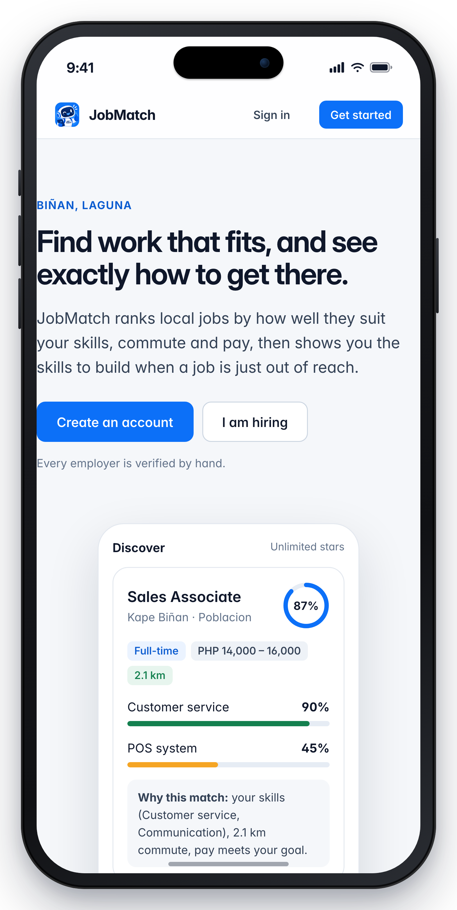

---

## Your 10-Phase Journey Map

| Phase | What you will do | Time |
|---|---|---|
| **1. Create your account** | Sign up, confirm your email, pick your role, and review privacy | ~2 min |
| **2. Set up your profile (5 steps)** | Add location, education, skills, résumé, and goals | ~5–8 min |
| **3. Make your profile stand out** | Add photos and certificates, hit 100%, run Résumé Review, use RA 11261 checklist | ~10 min |
| **4. Discover jobs that fit you** | Read cards, swipe or star, undo, review history, and filter | ~5 min/day |
| **5. Check details and apply** | Read match breakdown, apply in one tap, and view the job's skill plan | ~3 min/job |
| **6. Track everything in one place** | Manage **Preferred**, **Applications** + **Insights**, **Matches**, and alerts | ~2 min/day |
| **7. Talk to employers** | Start or reply to chats, use quick replies, and edit or reply to messages | Ongoing |
| **8. Ace the interview** | Confirm interviews on **Discover** and prepare with quizzes and tips | ~30 min prep |
| **9. Grow with your career breakdown** | Finish weekly tasks and quizzes to raise readiness and match scores | ~1–2 hrs/wk |
| **10. Get hired, and keep going** | Confirm offer details, update experience, and set your next goal role | Ongoing |

---

## Phase 1 – Create your account

*Simulan natin — isang minuto lang, may account ka na.*

### Step 1.1 – Sign up with your name and email

- **Where:** Welcome → Create your account (`#/` → `#/signup`)
- **Do this:**
  1. Tap **Get started** (or **Create an account**).
  2. Enter your **Full name**, **Email**, and a **Password** (8+ characters), then tap **Continue**.
  3. Open your email, tap the confirmation link, and tap **Go to sign in**.
- **What you'll see:** A **Check your inbox** screen showing where your confirmation link was sent.
- **Why it helps you:** Verifying your email protects your account and delivers shortlist and interview alerts right away.
- **Screenshot:**

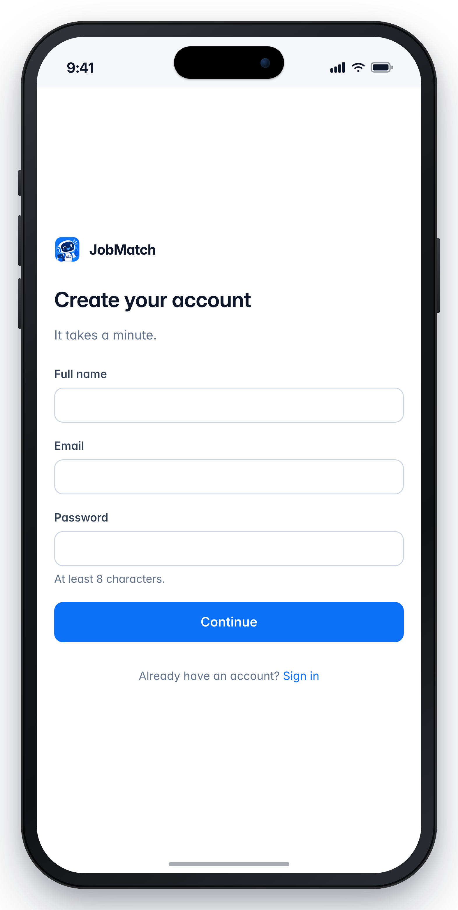

> **Tip:** Use an email you check on your phone daily so you never miss an employer reply.

---

### Step 1.2 – Pick your account type and accept privacy protections

- **Where:** Choose account type (`#/role`) → Privacy consent (`#/consent`)
- **Do this:**
  1. On **How will you use JobMatch?**, tap **I am looking for a job**.
  2. On **Before you continue**, read the privacy summary under RA 10173 (Data Privacy Act).
  3. Tick the consent checkbox and tap **Agree and continue**.
- **What you'll see:** Your 5-step guided profile setup (`#/onboarding`) opens right away.
- **Why it helps you:** Employers only see your first name, last initial, skills, and experience until shortlisting—and age, gender, and photos never affect ranking.
- **Screenshot:**

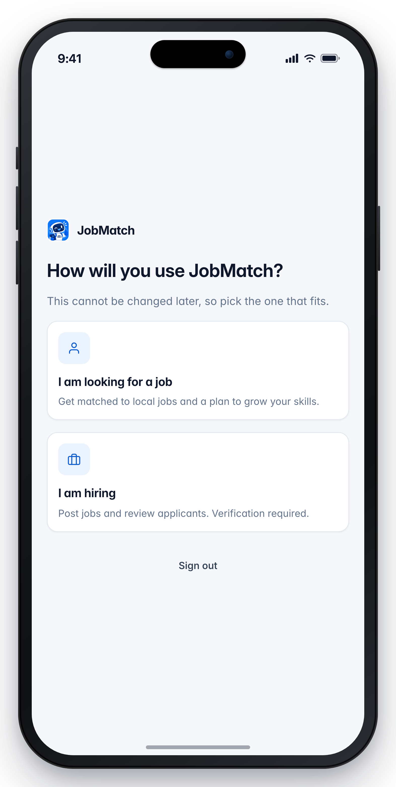

---

## Phase 2 – Set up your profile in 5 guided steps

*Limang maikling hakbang para makita agad ang mga trabahong bagay sa iyo.*

### Step 2.1 – Enter your basics and commute distance

- **Where:** Set up your profile → **Step 1 of 5: About you** (`#/onboarding`)
- **Do this:**
  1. Check your **Full name** and add your **Mobile number** and **Year of birth** (plus **Gender (optional)**).
  2. Type your city or barangay in **Where do you live?** and pick from the suggestions.
  3. Slide **Willing to commute** (1–60 km) to your comfortable travel limit, then tap **Continue**.
- **What you'll see:** Your commute distance updates live beside the slider and moves you to Step 2.
- **Why it helps you:** Location drives 20% of every match score, bringing realistic nearby jobs to the top.

> **Tip:** Your birth year, gender, and mobile number are never used for matching and stay private until shortlisted.

---

### Step 2.2 – Add your education

- **Where:** Set up your profile → **Step 2 of 5: Education** (`#/onboarding`)
- **Do this:**
  1. Pick your **Highest education**.
  2. Type your **School** and **Course or strand** and choose from the live suggestions (or enter your own).
  3. Enter **Year graduated (or expected)** and tap **Continue**.
- **What you'll see:** Clean education details saved to your draft profile.
- **Why it helps you:** Employers quickly spot relevant academic training for entry-level and OJT roles.

---

### Step 2.3 – Pick your skills and set each level

- **Where:** Set up your profile → **Step 3 of 5: Skills** (`#/onboarding`)
- **Do this:**
  1. Tap matching chips in **Suggested for you** or use **Search 300+ skills**.
  2. Open category sections to pick at least **3 skills**.
  3. Under **Selected skills**, choose **Beginner**, **Intermediate**, or **Advanced** for each skill, then tap **Continue**.
- **What you'll see:** Selected skills highlight in blue with level selectors right below.
- **Why it helps you:** Skills make up **55%**—more than half—of every match score.
- **Screenshot:**

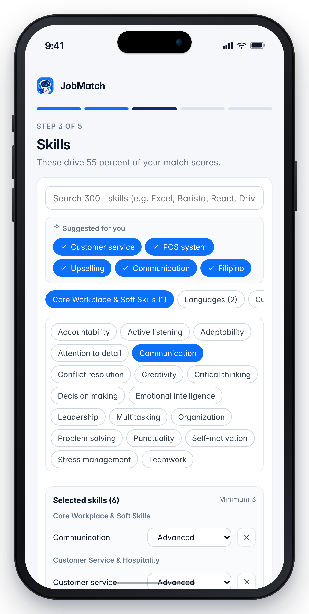

> **Tip:** Include everyday strengths like *Communication*, *Customer service*, *Microsoft Excel*, and *Teamwork* alongside technical skills.

---

### Step 2.4 – Upload your résumé and let JobMatch fill in the rest

- **Where:** Set up your profile → **Step 4 of 5: Résumé** (`#/onboarding`)
- **Do this:**
  1. Tap **Upload résumé** (PDF, DOCX, JPG, or PNG up to 5 MB), preview, and confirm.
  2. Tap **Update All Info** to auto-fill education, experience, skills, and a detailed **Professional summary**.
  3. Review the **Profile updated from résumé** popup, tap **Got it**, adjust any **Experience** entries if needed, and tap **Continue**.
- **What you'll see:** A summary of updated sections plus a green shield notice confirming that **Full Name, Contact Number, Date of Birth, and Email Address** were never changed.
- **Why it helps you:** One tap turns your résumé into a complete profile in seconds without touching your private details.
- **Screenshot:**

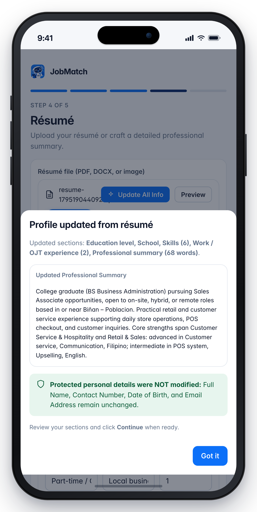

> **Tip:** No résumé file yet? Tap **Auto-generate** above **Professional summary** and use **Add experience** for OJT, school projects, or volunteer work.

---

### Step 2.5 – Choose your career goal, work setups, and pay target

- **Where:** Set up your profile → **Step 5 of 5: Goals** (`#/onboarding`)
- **Do this:**
  1. Pick a **Career goal** from 100+ categorized roles (or tap **Other / not listed** and type it under **In your own words**). Optionally choose **Target level** and **Target timeframe**.
  2. Select your **Fields that interest you**, accepted **Work setups** (**On-site**, **Hybrid**, **Remote**), and **Employment types**.
  3. Enter your **Minimum pay per month**, tick **Let employers find me**, and tap **Finish and see my matches**.
- **What you'll see:** Your personalized **Discover** feed opens immediately.
- **Why it helps you:** Your goal builds your personal career roadmap while work setups and pay fine-tune every match card.
- **Screenshot:**

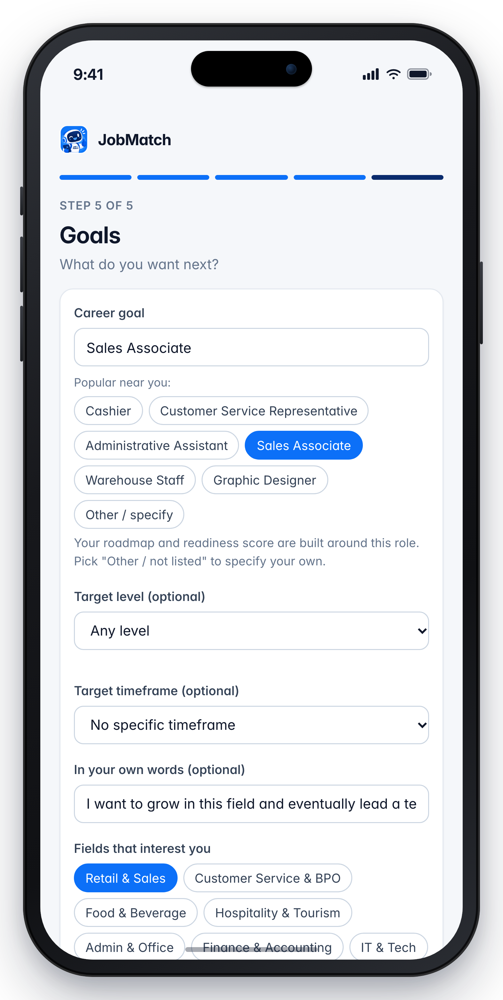

---

## Phase 3 – Make your profile stand out

*Ayusin ang profile mo para mas kapansin-pansin sa mga verified employers.*

### Step 3.1 – Add photos, upload certificates, and hit 100% strength

- **Where:** **Profile** (`#/profile`)
- **Do this:**
  1. Tap the camera icon on your avatar (or **Upload profile picture**) to crop a circular photo with live preview.
  2. Tap **Upload professional photo** to add a 3:4 portrait with crop preview.
  3. Complete all 7 core fields so **Profile strength** reaches **100%**.
  4. Under **Certificates & credentials**, add a title, optional details, and tap **Upload certificate or credential**.
  5. Tap **Save changes**.
- **What you'll see:** A 100% green **Profile strength** bar, crisp circular avatar, and previewable credentials.
- **Why it helps you:** A 100% profile with clear credentials builds instant confidence once shortlisted and gives you priority visibility with employers.
- **Screenshot:**

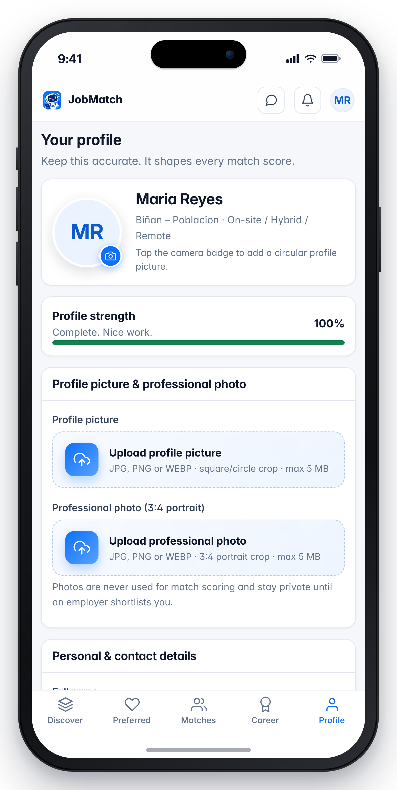

> **Tip:** Photos are never used in match scores and remain hidden until an employer shortlists you.

---

### Step 3.2 – Run Résumé Review and apply clear fixes

- **Where:** **More → Résumé review** (`#/resume-review`)
- **Do this:**
  1. Check your uploaded résumé (or add a **Résumé or portfolio link** or paste your résumé text).
  2. Tap **Review my résumé**.
  3. Read your score ring, **Strong areas**, **Areas to improve & solutions** (with fixes and examples), and **Employer-appeal recommendations**.
  4. Update your profile or résumé and re-run **Review my résumé** to see your higher score.
- **What you'll see:** A 0–100 score and specific, plain-English fixes—without ever sending your name, age, gender, or photo.
- **Why it helps you:** You fix weak spots *before* a hiring manager reads your application.
- **Screenshot:**

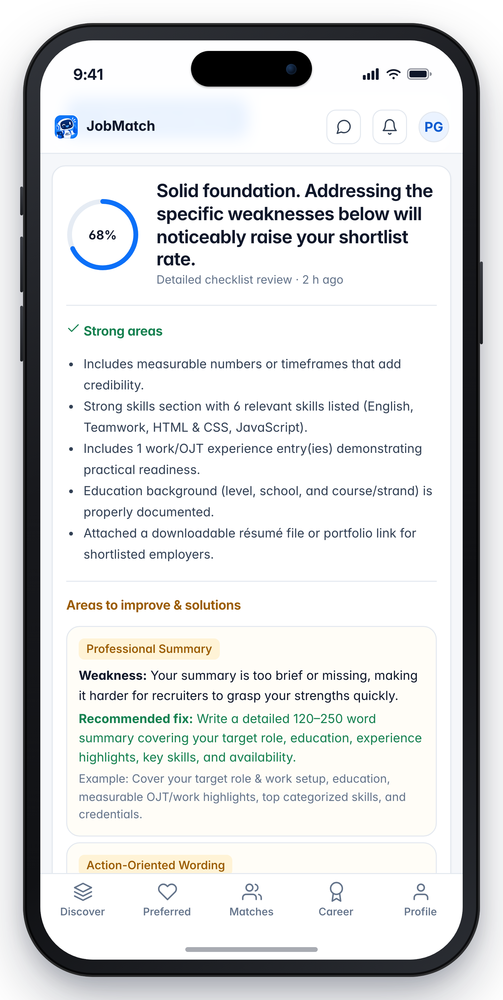

---

### Step 3.3 – Use the First-Time Jobseeker Checklist (RA 11261) and Discoverability

- **Where:** **More → First-time jobseeker** (`#/checklist`) and **Settings** (`#/settings`)
- **Do this:**
  1. Open **First-time jobseeker** (`#/checklist`) to track all 7 fee-waived pre-employment documents under RA 11261 (Barangay Certification, Oath of Undertaking, Police clearance, NBI clearance, PSA birth certificate, TIN/SSS/PhilHealth/Pag-IBIG, and public hospital Medical certificate).
  2. Tap **View sample image** for the **Visual Résumé Sample Template**, or tap **Sample** beside any document to preview it.
  3. Toggle each item on as you finish it, then open **Settings** (`#/settings`) and confirm **Discoverability** is turned on.
- **What you'll see:** A live progress bar for your first-timer documents and an active **Discoverability** toggle so employers can invite you.
- **Why it helps you:** Having your fee-waived clearances ready lets you say yes to a job offer without delay.

> **Tip:** Visit your Barangay Hall first—your **Barangay Certification** and **Oath of Undertaking** waive the fees for the other documents.

---

## Phase 4 – Discover jobs that fit you

*Mag-swipe nang matalino — kita mo agad ang match score bago ka mag-apply.*

### Step 4.1 – Read a job card and swipe with confidence

- **Where:** **Discover** (`#/deck`)
- **Do this:**
  1. Check the job title, work-setup badge (**On-site**, **Hybrid**, or **Remote**), verified company check, and **Match % ring** at the top.
  2. Scan the 4:3 listing photo, circular company logo, location/distance (or **Remote**), pay, skills (green = you have it; amber = to build), and **Why this match**.
  3. Swipe right (or tap **Heart**) to **Save** to **Preferred**, swipe left (or tap **✕**) to **Pass**, swipe up (or tap **Star**) to **Star as top pick** (unlimited stars), or tap the card for full details.
- **What you'll see:** Clear **SAVE**, **PASS**, or **TOP PICK** stamps and your next matched job right behind it.
- **Why it helps you:** You see why a job fits in five seconds—and starring tells employers it is your top choice.
- **Screenshot:**

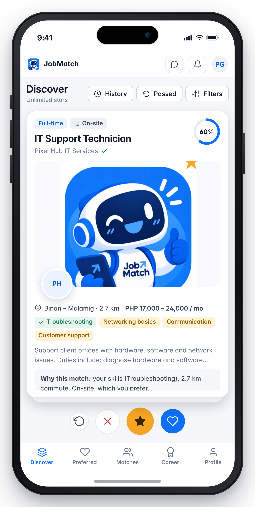

> **Tip:** On desktop, arrow keys work too: **Right** = Save, **Left** = Pass, **Up** = Star.

---

### Step 4.2 – Use Undo, Passed, History, and Filters

- **Where:** **Discover** (`#/deck`) → **Undo** (`↺`), **Passed**, **History**, and **Filters**
- **Do this:**
  1. Tap **Undo** (`↺`) or **Passed** to return your previous card to the deck.
  2. Tap **History** to inspect every saved, starred, and passed job—and tap **Re-run passed jobs** anytime.
  3. Tap **Filters** to filter by **Only jobs within my commute limit**, **Work setup** (*On-site*, *Hybrid*, *Remote*), **Employment type**, **Specific area**, and **Pays at least**, then tap **Apply filters**.
- **What you'll see:** Your deck updates immediately with a filter count on the **Filters** button.
- **Why it helps you:** You never lose a good role by swiping too fast and can narrow down to your exact setup and pay in two taps.
- **Screenshot:**

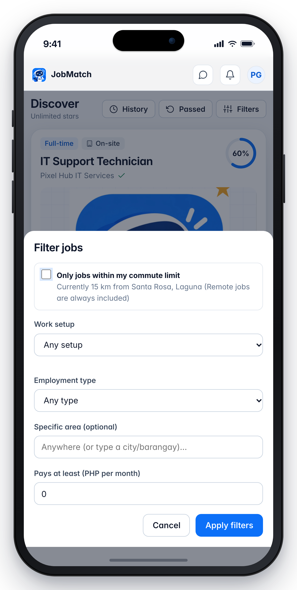

---

## Phase 5 – Check the details and apply

*Siguraduhing swak bago mag-apply — isang tap lang, sent na.*

### Step 5.1 – Review your match breakdown and apply

- **Where:** **Job details** (`#/jobs/:id`)
- **Do this:**
  1. Check **Pay**, **Work setup**, **Distance**, and the **Verified business** badge.
  2. Read **Why you match**: **Skills (55%)**, **Location (20%)**, **Interests (15%)**, and **Pay (10%)**, plus **Skills for this job**, **About the job**, and **About [Company]**.
  3. Tap **Apply now** (or **Save** for later). Tap **Report this listing** at the bottom if anything seems suspicious.
- **What you'll see:** A green confirmation bar ("You applied just now. Status: applied.").
- **Why it helps you:** Employers see only a masked name (such as *Maria R.*) plus your skills and experience until they shortlist you—keeping hiring fair.
- **Screenshot:**

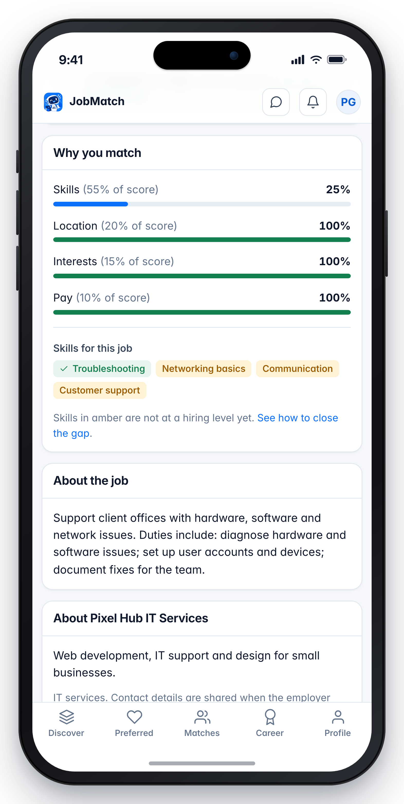

> **Tip:** Apply even if your score is 60–75%—then use the job's skill roadmap to close the remaining amber skills.

---

### Step 5.2 – Open the Career Breakdown for that job

- **Where:** **Job details** (`#/jobs/:id`) → **See how to close the gap** (`#/career/job/:id`)
- **Do this:**
  1. Tap **See how to close the gap** under **Skills for this job**.
  2. Review your readiness ring, **Learning progress**, **Skill readiness** bars, and **What you will do**.
  3. Scroll to **Your roadmap** to start building the exact missing skills for this listing.
- **What you'll see:** A custom skill readiness report and weekly action plan linked straight to that job.
- **Why it helps you:** You know *exactly* what to learn next to become a top match for the role.
- **Screenshot:**

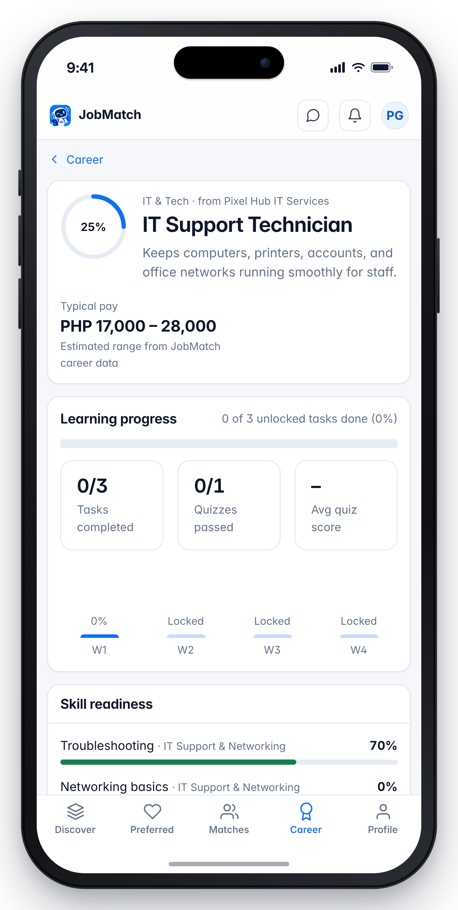

---

## Phase 6 – Track everything in one place

*Walang nakakaligtaan — lahat ng saved jobs, applications, at matches mo nasa isang lugar.*

### Step 6.1 – Apply from Preferred when ready

- **Where:** **Preferred** (`#/preferred`)
- **Do this:**
  1. Open **Preferred** from the bottom bar—your starred top picks sit at the top.
  2. Tap any job to review it, tap **Apply** right on the row, or tap **✕** to remove it.
- **What you'll see:** Every saved job with its logo, pay, setup badge, match %, and status.
- **Why it helps you:** Save jobs quickly anytime and apply thoughtfully when you are ready.

---

### Step 6.2 – Track your Applications timeline and Insights

- **Where:** **More → Applications** (`#/applications`)
- **Do this:**
  1. Open **Applications** to see every job you applied to and whether it is **viewed by employer**.
  2. Follow your badge from **Applied** → **Shortlisted** → **Hired** (or **Not selected**, which links to **See what to improve for roles like this**).
  3. Tap **Insights** to see **Your rank by match score**, **Your match score**, **Median applicant score**, and **Average employer response** time.
- **What you'll see:** Real-time application progress, a **Chat** button on shortlisted roles, and your ranking stats.
- **Why it helps you:** You always know where you stand instead of waiting in the dark.
- **Screenshot:**

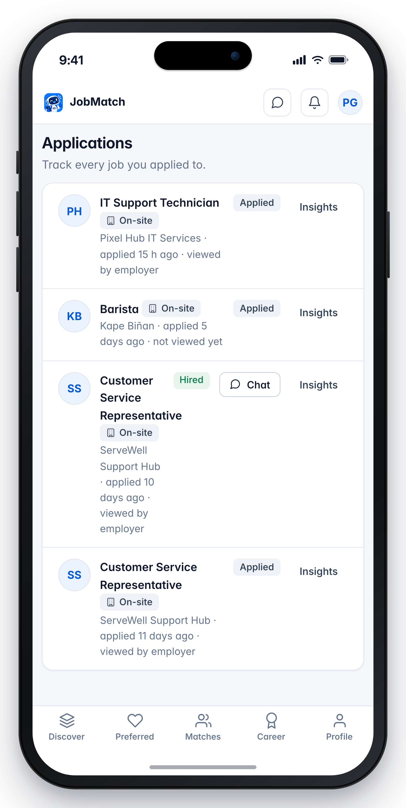

---

### Step 6.3 – View Matches, alerts, and data settings

- **Where:** **Matches** (`#/matches`), **Notifications** (`#/notifications`), and **Settings** (`#/settings`)
- **Do this:**
  1. When shortlisted, open **Matches** (`#/matches`) to see the employer's revealed contact person, mobile, email, and address, then tap **Message [Company]**.
  2. Tap the bell icon (**Notifications**, `#/notifications`) for early job alerts, invites, and updates, or tap **Mark all as read**.
  3. Open **Settings** (`#/settings`) to toggle **Matches**, **Application updates**, **Messages**, and **Tips** alerts, change your password, or tap **Download my data** (`jobmatch-my-data.json`).
- **What you'll see:** Direct contact cards for every shortlisted or hired employer and full control over alerts and personal data.
- **Why it helps you:** Your contact info stays private until mutual interest is confirmed, then everything opens cleanly in one spot.
- **Screenshot:**

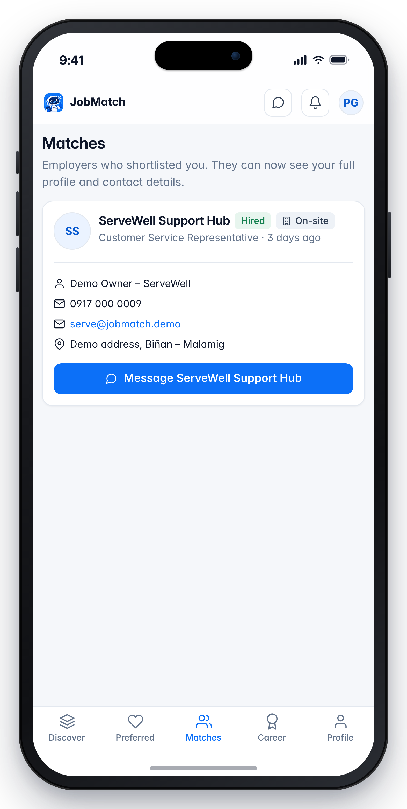

---

## Phase 7 – Talk to employers

*Diretsong usapan, mabilis at propesyonal.*

### Step 7.1 – Start a chat or send a quick reply

- **Where:** **Messages** (`#/messages`, `#/messages/:id`)
- **Do this:**
  1. Tap any conversation, or tap **New** to open **Start a message** and choose a shortlisted match.
  2. Tap a **quick-reply chip** above **Write a message** (such as *"Hi! I am available for an interview."*) or type your own note, then tap **Send**.
- **What you'll see:** Instant delivery with timestamps and clear thread history.
- **Why it helps you:** Quick replies make starting a polite hiring conversation effortless.

> **Tip:** Share your full name, the role, and two or three time slots when you are free for an interview.

---

### Step 7.2 – Reply, edit, unsend, or report in chat

- **Where:** Inside a conversation (`#/messages/:id`)
- **Do this:**
  1. **Press and hold** any message (or tap `⋯` / right-click on desktop).
  2. Choose **Reply**, **Copy**, **Edit**, **Unsend**, or **Remove for you** (plus **Report** on received messages).
  3. Use the flag icon (**Report**) or **Block** button at the top right whenever needed for safety.
- **What you'll see:** A crisp options menu beside the message bubble; edited texts show a subtle *edited* label.
- **Why it helps you:** You can fix typos cleanly, reply directly to schedule details, and stay protected with one-tap reporting and blocking.
- **Screenshot:**

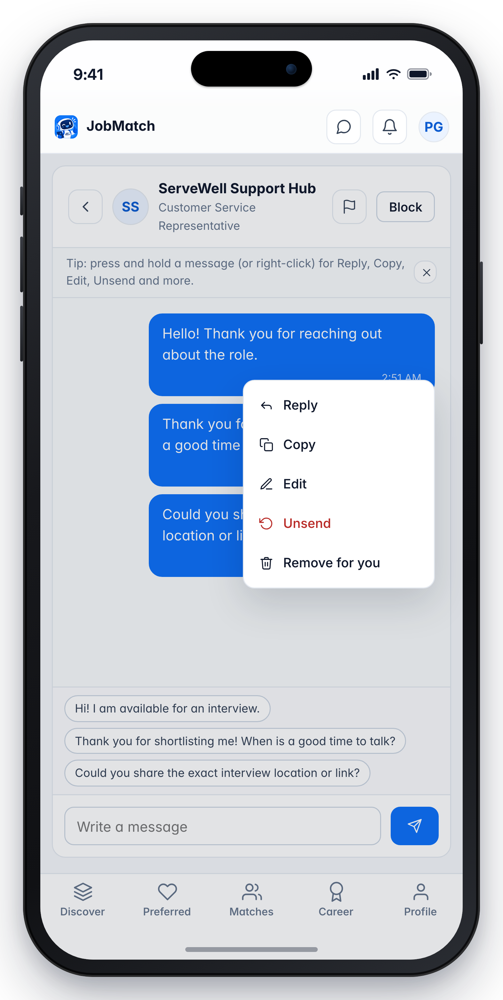

---

## Phase 8 – Ace the interview

*Handa ka na — kumpirmahin ang schedule at mag-practice bago ang interview.*

### Step 8.1 – Confirm your upcoming interview on Discover

- **Where:** **Discover** (`#/deck`, top **Upcoming Interviews** card)
- **Do this:**
  1. Open **Discover** to see your **Upcoming Interviews** card at the top.
  2. Check the date, time, **Online** or **On-site** badge, and **Join meeting link** or street address.
  3. Tap **Confirm**.
- **What you'll see:** Your status badge turns green (**confirmed**) and notifies the employer immediately.
- **Why it helps you:** Quick confirmation shows punctuality and professionalism from the start.
- **Screenshot:**

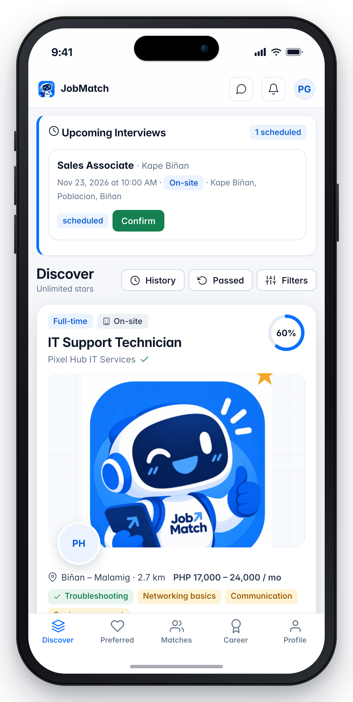

---

### Step 8.2 – Follow your 30-minute interview prep checklist

- **Where:** **Career breakdown** (`#/career/job/:id`) and **Résumé review** (`#/resume-review`)
- **Do this:**
  1. Re-read **What you will do** and the top skills in the job's **Career breakdown**.
  2. Retake one short quiz to refresh key concepts.
  3. Review your **Résumé review** strengths so you can share concrete examples from school, OJT, or past jobs.
  4. Test your audio/video 15 minutes early for **Online** interviews, or pack a printed résumé, ID, and certificates for **On-site** visits.
- **What you'll see:** Clear talking points aligned directly to what the employer listed.
- **Why it helps you:** Targeted preparation gives you calm, confident answers.

---

## Phase 9 – Grow with your career breakdown

*Bawat linggo, mas lumalapit ka sa pangarap mong trabaho.*

### Step 9.1 – Complete weekly tasks, pass quizzes, and explore your career ladder

- **Where:** **Career** (`#/career`) → **Open roadmap** (`#/career/role/:id`)
- **Do this:**
  1. Open **Career** to view **Your goal** readiness ring, **Jobs you are going for**, and **Explore roles**.
  2. Tap **Open roadmap** to check **Learning progress**, **Skill readiness**, and **What you will do**.
  3. Open **Week 1** (and Weeks 2–4), finish each **Learn** and **Practice** task, and toggle its switch on.
  4. Tap **Take quiz** once that week's preliminary tasks are done, review any question freely before hitting **Submit**, and score **70%+** to pass (or tap **Retake** after reviewing).
  5. Scroll down to view your Entry → Mid → Senior career path with typical pay ranges and tap **Recommended courses**.
- **What you'll see:** Your **Learning progress** chart and **Skill readiness** rise—lifting your match percentages across **Discover**.
- **Why it helps you:** One or two focused hours a week turns reach roles into strong matches.
- **Screenshot:**

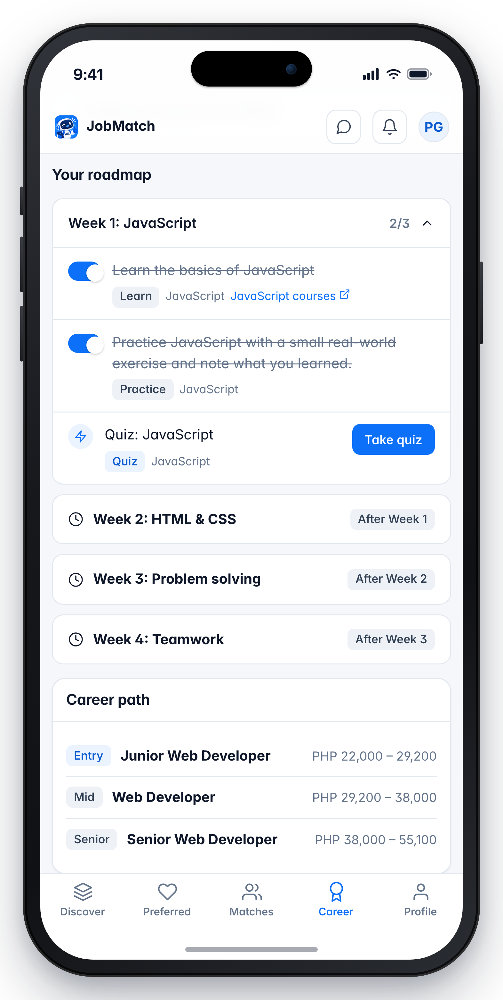

> **Tip:** Come back every weekend to check off one week of tasks, then add newly learned skills to your **Profile** (`#/profile`).

---

## Phase 10 – Get hired, and keep moving forward

*Congrats! Simula pa lang ito ng mas magandang career mo.*

### Step 10.1 – Confirm your offer and update your experience

- **Where:** **Applications** (`#/applications`), **Messages** (`#/messages`), and **Profile** (`#/profile`)
- **Do this:**
  1. Check your green **Hired** badge on **Applications** or **Matches**.
  2. Confirm your start date, shift, location, and onboarding requirements in **Messages**.
  3. Add your new role under **Profile → Experience** and optionally turn off **Discoverability** in **Settings** (`#/settings`).
- **What you'll see:** Your offer details stay safely recorded in chat and your profile stays current.
- **Why it helps you:** Keeping your record updated makes every future career step smoother.

---

### Step 10.2 – Pick your next goal role

- **Where:** **Profile** (`#/profile`) and **Career** (`#/career`)
- **Do this:**
  1. Check the next level on your career path (for example, *Mid-Level* or *Supervisor*).
  2. Update **Career goal** on **Profile** and tap **Save changes**.
  3. Open **Career** to start your new 4-week roadmap.
- **What you'll see:** A fresh readiness ring and skill roadmap built for your next milestone.
- **Why it helps you:** JobMatch keeps coaching you well beyond your first day on the job.

---

## Quick-Reference Cheat Sheet

| Gesture / Button | Where | What it does |
|---|---|---|
| **Swipe right** / **Heart** | **Discover** (`#/deck`) | Saves the job to **Preferred** |
| **Swipe left** / **✕** | **Discover** (`#/deck`) | Passes on the job |
| **Swipe up** / **Star** | **Discover** (`#/deck`) | Stars as a **Top Pick** (unlimited stars) |
| **Tap card** | **Discover** (`#/deck`) | Opens **Job details** (`#/jobs/:id`) |
| **Arrow keys** (desktop) | **Discover** (`#/deck`) | **Right** = Save, **Left** = Pass, **Up** = Star |
| **Undo** (`↺`) / **Passed** | **Discover** (`#/deck`) | Brings back your previous card |
| **History** | **Discover** (`#/deck`) | Full swipe log + **Re-run passed jobs** |
| **Filters** | **Discover** (`#/deck`) | Filter by commute, **Work setup**, type, area, and pay |
| **Update All Info** | **Onboarding** / **Profile** | Auto-fills profile from résumé (keeps personal details safe) |
| **Press & hold message** | **Messages** (`#/messages/:id`) | Opens **Reply**, **Copy**, **Edit**, **Unsend**, **Remove for you** |
| **Confirm** | **Discover** (top card) | Confirms a scheduled interview |

---

## Frequently Asked Questions (FAQ)

### 1. What do employers see before shortlisting me?
Only your **first name and last initial** (like *Maria R.*), skills, education, experience, accepted work setups, and summary. Full name, phone, email, age, gender, photos, and your résumé file stay hidden until shortlisted.

### 2. How is my match score calculated?
**Skills (55%)**, **Location (20%)**, **Interests (15%)**, and **Pay (10%)**, gently refined by your swipes. Age, gender, and photos are never used.

### 3. Can I edit my profile or commute limit later?
Yes—open **Profile** (`#/profile`) anytime, adjust any field or slider, and tap **Save changes**.

### 4. What happens after an employer shortlists me?
You get an **"It is a Match!"** alert, the employer appears in **Matches** (`#/matches`) with contact details revealed, they can view your full profile and résumé, and a direct chat opens in **Messages**.

### 5. What does starring a job do?
Starring marks a role as a **Top Pick** so you appear highlighted at the top of the employer's ranked applicant list. You can star as many jobs as you want.

### 6. How do I prepare for an interview?
Tap **Confirm** on the **Upcoming Interviews** card, review the job's **Career breakdown** (`#/career/job/:id`), retake one quick skill quiz, and check your **Résumé review** strengths.

### 7. How do I download my data or delete my account?
Open **Settings → Your data** (`#/settings`). Tap **Download my data** to save `jobmatch-my-data.json`, or tap **Delete my account**, type `DELETE`, and tap **Delete forever** to remove everything permanently.

### 8. How do I know employers are legitimate?
Administrators verify every business's DTI/SEC/CDA certificate, Mayor's Permit, and owner ID by hand before granting the green **Verified** badge. You can report any listing or message in one tap.

---

## Appendix: How Employers Find You (Behind the Scenes)

Knowing how employers hire on JobMatch helps you stand out from the start:

### 1. Businesses get verified and post clear roles
Employers complete **Company and team** (`#/employer/company`) with their logo and permits to earn the green **Verified** badge. From **Overview** (`#/employer`), they tap **Post a job** (`#/employer/jobs/new`) to set the role, **Work setup** (*On-site*, *Hybrid*, or *Remote*), pay range, 4:3 photo, and required skills.

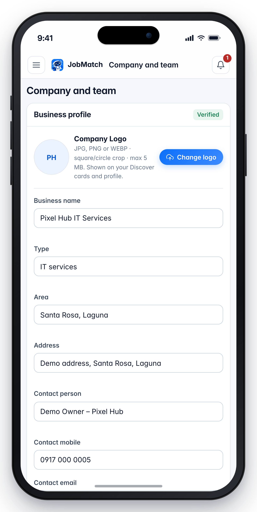

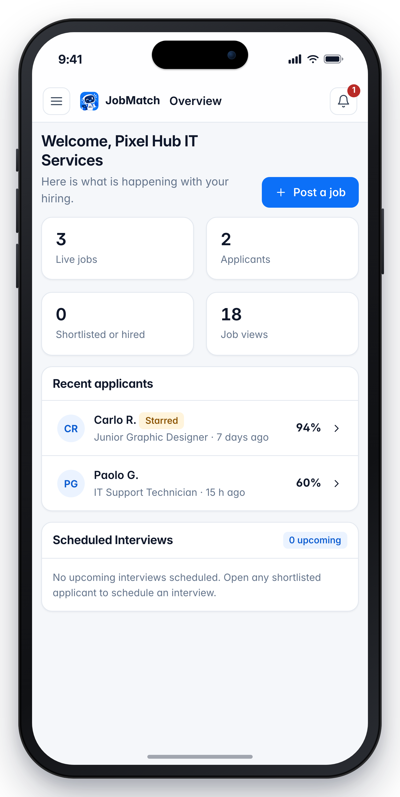

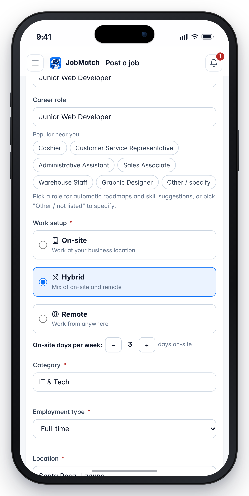

### 2. Employers manage listings and invite discoverable candidates
On **Jobs** (`#/employer/jobs`), employers track live roles and applicant counts. On **Candidate search** (`#/employer/candidates`), they filter opted-in seekers by skill, area, and work setup, view match rings, and tap **Invite to apply**—keeping your contact info private until you apply and get shortlisted.

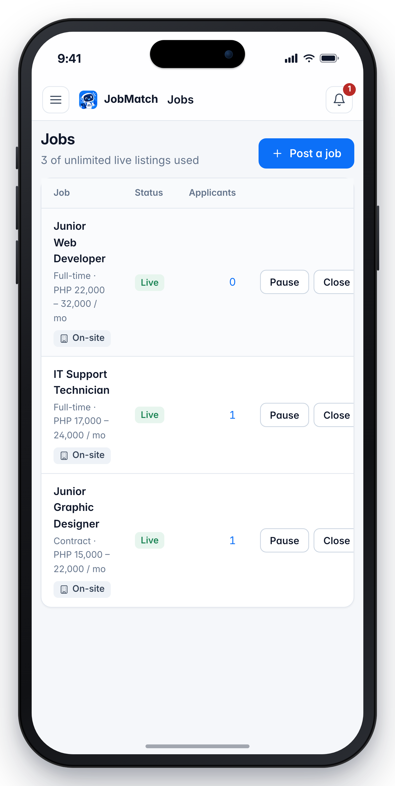

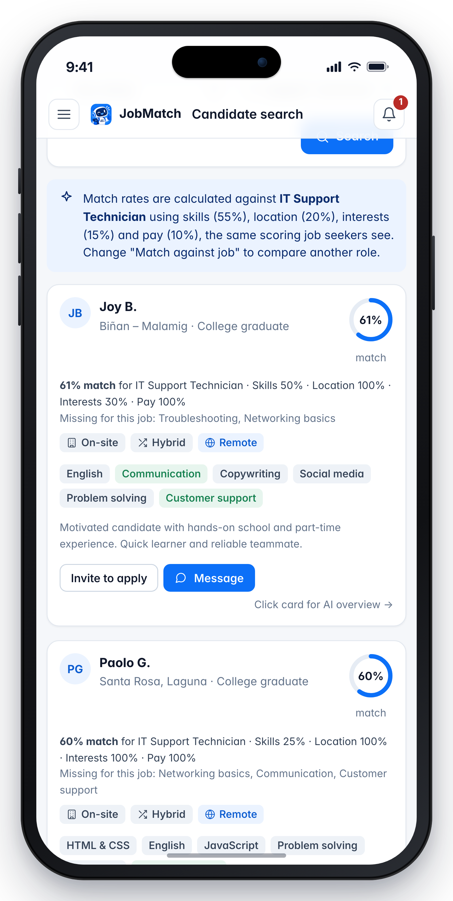

### 3. Employers review ranked applicants fairly
On **Applicants** (`#/employer/jobs/:id/applicants`), candidates are ranked by match score with **Starred** picks first. Tapping a candidate opens the review drawer showing match score, skills, education, and summary—while keeping personal details hidden until the employer taps **Shortlist**.

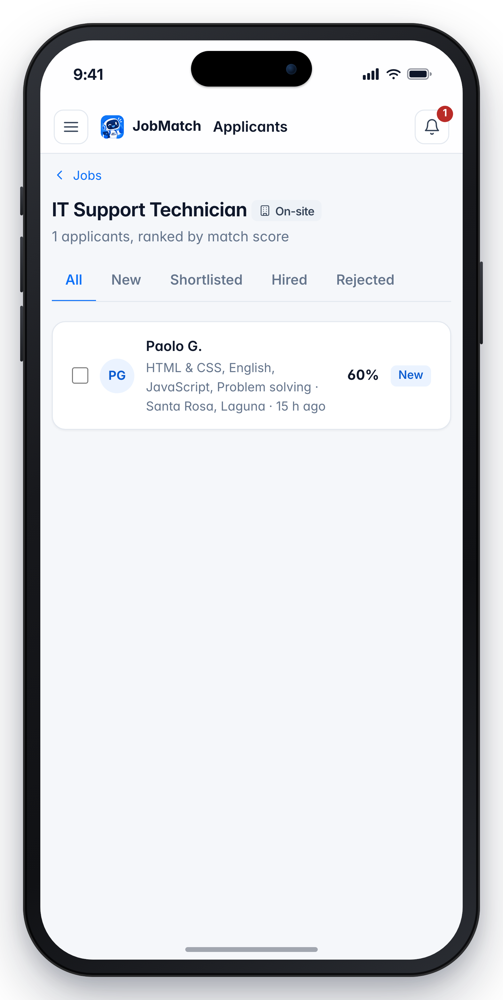

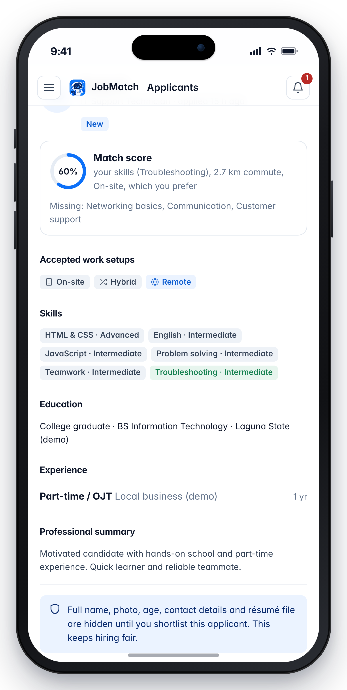

### 4. Shortlist, schedule an interview, and message you directly
After tapping **Shortlist**, contact details open up and chat begins in **Messages** (`#/messages/:id`). Employers also tap **Schedule Interview** to send a date, time, **Online** or **On-site** format, and link or address straight to your **Discover** dashboard.

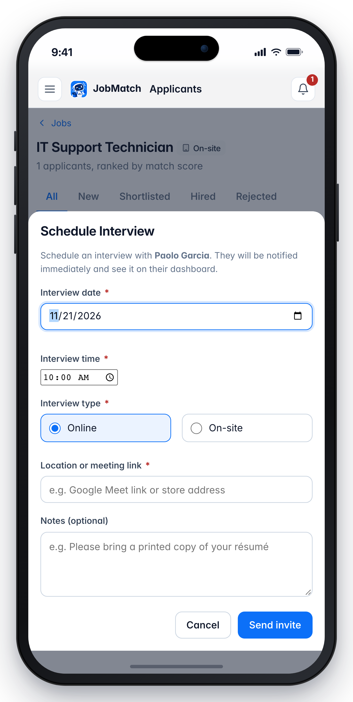

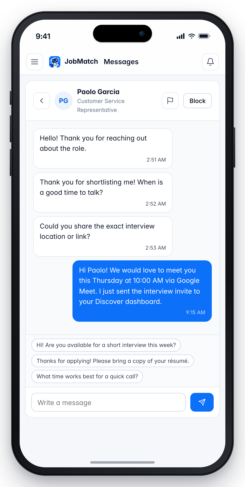

### 5. Employers track analytics to improve hiring
On **Analytics** (`#/employer/analytics`), employers review views, saves, stars, application trends, automated suggestions, and downloadable PDF, Excel, or CSV reports to keep their job posts clear and responsive.

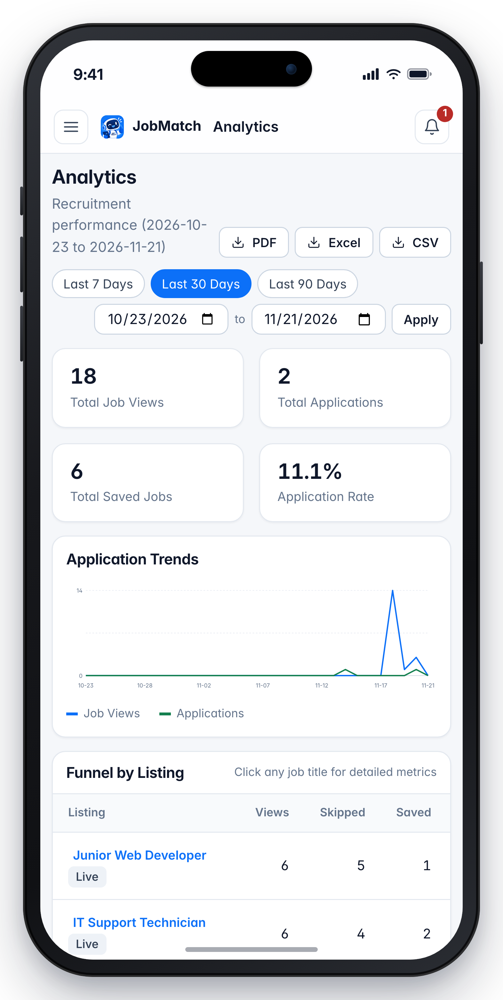

---

## Ready to take the first step?

Your skills, commute, and goals belong in one clear place—with verified local employers waiting to meet you.

**Create your account and see your first matches today.**
